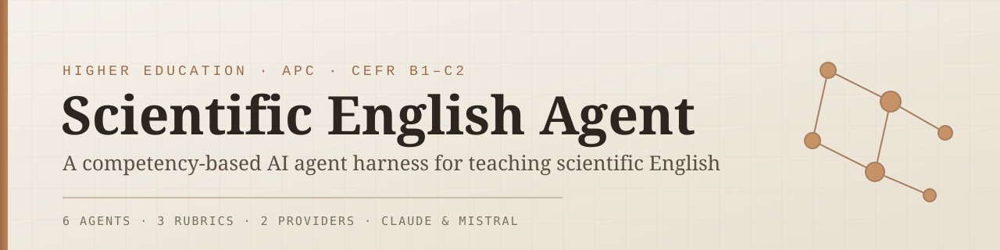
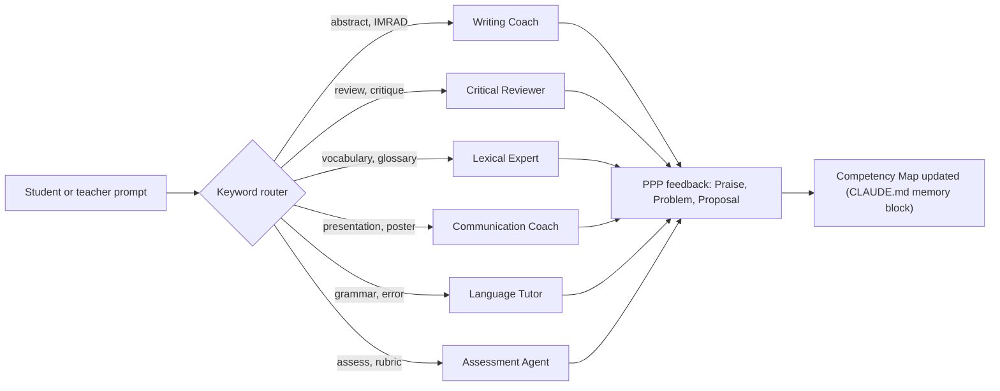

# Scientific English Agents

**Open-source pedagogical AI system for teaching scientific English in higher education**

[](https://creativecommons.org/licenses/by/4.0/)
[](https://github.com/TheAIbreakfastclub/scientific_english_agents-public/releases/tag/v3.0.0)
[](doc/competency-map.md)
[](https://github.com/TheAIbreakfastclub/scientific_english_agents-public)

---


_AI-powered feedback for scientific writing — Professional, formative, integrity-first_

---

## What is this?

Scientific English Agents is an open-source system of AI-powered pedagogical tools designed to help university teachers and students master academic writing, presentations, and critical reading in English across scientific disciplines.

The system consists of:

- **Six specialized AI agents** — each handles a different aspect of scientific communication (writing, reviewing, vocabulary, presenting, grammar, assessment)
- **Three validated assessment rubrics** — aligned to CEFR B2–C1 levels
- **Complete pedagogical frameworks** — feedback protocols, error taxonomy, competency tracking
- **Two AI providers** — Claude Code (Anthropic) or Python API (Mistral, EU-hosted)
- **Full documentation** — for teachers, students, and developers

**Designed for:** University language coordinators, English for Science & Technology (EST) teachers, Academic Purpose (EAP) instructors, and researchers teaching in English.

---

## Approche par Competences (APC)

Instead of a single grade, the system tracks **observable competencies** --
things a student can demonstrably _do_ in scientific English: write a
structured abstract (WP1), hedge claims appropriately (LC1), deliver a
10-minute conference talk (OM1), write a structured peer review (CR3), and
16 more. These short codes (WP*, OM*, CR*, LC*) are used throughout the
project -- in CLAUDE.md, progress trackers, and feedback -- and every one
is defined in the **[Competency Map](doc/competency-map.md)**.



---

## See it in action

**Before** (student draft, Results section):

> "We did the experiment with the mice and we saw that the results was very good and proves our hypothesis."

**After** (Writing Coach, PPP feedback):

> **Praise** -- Clear that you ran the experiment and have a result to report.
>
> **Problem** -- (1) "the results was" needs subject-verb agreement; (2) "proves" overstates what a single experiment shows (competency LC1: hedging).
>
> **Proposal** -- Try: "The results indicate that [finding], which supports our hypothesis that ..."

---

## RGPD / Mistral (EU-hosted option)

Institutions that require EU-hosted data processing can run the Mistral
provider instead of Anthropic's API (Option B below). See
[doc/ethics.md](doc/ethics.md) for the full data-protection framework:
anonymised student codes, `.gitignore` rules for student data, and an
AI-use disclosure template for syllabi.

---

## Why use this system?

### For Teachers

- **Formative feedback at scale.** AI provides scaffolded feedback without writing student work.
- **Competency-aligned.** Tracks CEFR levels and domain-specific skills (abstracts, IMRAD, presentations, peer review).
- **Respects academic integrity.** The system guides and models; it never produces student submissions.
- **Privacy-compliant.** RGPD support built in. Student data stays private (Mistral = EU hosting).
- **Free and modifiable.** CC-BY-4.0 licence. Adapt for your institution.

### For Students

- **24/7 writing support.** Get feedback on abstracts, lab reports, introductions, and presentations.
- **Targeted error diagnosis.** The system identifies your specific language gaps and provides focused practice.
- **Domain-aware.** Scaffolds and vocabulary tailored to your field (biology, medicine, chemistry, engineering).
- **Progress tracking.** See improvement in competencies week by week.
- **Low-stakes practice.** Work privately before submitting to instructors.

---

<details>
<summary><b>How it works</b></summary>

### The Agent Router

When you send a message, the system identifies your task and routes you to the appropriate agent:

| Tell the system...              | Agent activated...  |
| ------------------------------- | ------------------- |
| "Help me write an abstract"     | Writing Coach       |
| "Review my introduction"        | Writing Coach       |
| "Peer review this paper"        | Critical Reviewer   |
| "What vocabulary should I use?" | Lexical Expert      |
| "I'm presenting tomorrow"       | Communication Coach |
| "Why is my grammar wrong?"      | Language Tutor      |
| "Grade my essay"                | Assessment Agent    |

You don't choose manually. Just describe what you need.

### Pedagogical Design

Each agent follows the same proven feedback structure:

1. **Praise** — Identify what the student does well (with evidence)
2. **Problem** — Point out what needs improvement (with examples)
3. **Proposal** — Suggest revision strategy and model sentence
4. **Micro-task** — One actionable homework task

This approach, called **PPP feedback**, minimizes overwhelm and focuses effort.

</details>

---

<details>
<summary><b>What each agent does</b></summary>

**Writing Coach**
Structures scientific writing (abstracts, IMRAD sections, lab reports). Explains move-by-move rhetorical structure, not just grammar. Provides models and revision strategies.

**Critical Reviewer**
Teaches peer review and argumentation. Simulates journal editor feedback. Helps students critique papers constructively and receive feedback with resilience.

**Lexical Expert**
Builds academic and domain-specific vocabulary. Includes Academic Word List (Coxhead 2000), domain glossaries, and collocation training. Teaches register consistency.

**Communication Coach**
Prepares scientific presentations and posters. Structures slide decks, teaches presentation language, guides Q&A strategy. Includes real-time delivery feedback.

**Language Tutor**
Grammar and language clinics. Covers tense management (IMRAD), passive voice, hedging language (expressing uncertainty appropriately), and register consistency.

**Assessment Agent**
Rubric-based grading and feedback. Grades using validated rubrics (IMRAD /20, abstract /10, oral /20). Justifies every score with textual evidence. Declares AI involvement for official records.

</details>

---

## Getting Started

### **Option A: Fast Setup (Automatic installer) — Recommended**

Use the built-in install script for your OS. This handles all steps automatically.

<details>
<summary><b>Windows Setup (PowerShell)</b></summary>

**Prerequisites:**

- Windows 10/11
- PowerShell (right-click Start Menu → Windows PowerShell or search "PowerShell")

**Steps:**

1. **Check Windows execution policy** (one-time setup)

   PowerShell blocks unsigned scripts by default. Run this once:

   ```powershell
   Set-ExecutionPolicy -ExecutionPolicy RemoteSigned -Scope CurrentUser
   ```

   Press `Y` when prompted. After this, all `.ps1` scripts on your computer will run.

   **Alternative** (if you don't want to change system settings):

   ```powershell
   powershell -ExecutionPolicy Bypass -File ".\build\windows_install.ps1"
   ```

2. Download this repository as ZIP and extract it to a folder (e.g., `C:\Users\YourName\Documents\scientific_english_agents`)

3. Open PowerShell:
   - Right-click inside the folder
   - Select "Open PowerShell window here"

4. Run the installer:

   ```powershell
   .\build\windows_install.ps1
   ```

5. Choose your AI provider:
   - Press `A` for Claude Code (Node.js required, easier)
   - Press `B` for Mistral (Python 3.8–3.12 required, EU-hosted)

6. Paste your API key when prompted (keep it private)

7. Follow the on-screen instructions to configure `CLAUDE.md` or `MISTRAL.md`

**Done!** You can now type `claude` (Option A) or `python providers\mistral\session.py` (Option B) to start.

</details>

<details>
<summary><b>macOS / Linux Setup (Bash)</b></summary>

**Prerequisites:**

- macOS or Linux terminal
- Bash shell (standard)

**Steps:**

1. Download this repository as ZIP and extract it to a folder:

   ```bash
   unzip scientific_english_agents-main.zip
   cd scientific_english_agents-main
   ```

2. Make the installer executable:

   ```bash
   chmod +x build/linux_install.sh
   ```

3. Run the installer:

   ```bash
   ./build/linux_install.sh
   ```

4. Choose your AI provider:
   - Type `A` for Claude Code (Node.js required, easier)
   - Type `B` for Mistral (Python required, EU-hosted)

5. Paste your API key when prompted (keep it private)

6. Follow the on-screen instructions to configure `CLAUDE.md` or `MISTRAL.md`

**Done!** You can now type `claude` (Option A) or `python providers/mistral/session.py` (Option B) to start.

</details>

---

### **Option B: Manual Setup (Step-by-step for beginners)**

If you prefer to understand each step, follow this guide. It takes about 10 minutes.

<details>
<summary><b>Option B.1: Claude Code (Recommended)</b></summary>

**What you need:**

1. Node.js installed ([download here](https://nodejs.org) if you don't have it)
2. An Anthropic API key ([free credits available](https://platform.claude.com/docs/en/api/admin/api_keys/retrieve))
3. This repository (ZIP download from [GitHub](https://github.com/TheAIbreakfastclub/scientific_english_agents-public))

**Installation (5 minutes):**

**Step 1: Install Node.js (if you don't have it)**

- Go to https://nodejs.org
- Download the latest LTS version (Long Term Support)
- Run the installer and follow the wizard
- Close and reopen your terminal after installing

**Step 2: Download and extract this repository**

- Go to https://github.com/TheAIbreakfastclub/scientific_english_agents-public
- Click the green "Code" button → "Download ZIP"
- Unzip to a folder on your computer (e.g., `C:\Users\YourName\Documents` on Windows or `~/Documents` on Mac/Linux)
- Open a terminal/PowerShell in that folder

**Step 3: Install Claude Code globally**

```bash
npm install -g @anthropic-ai/claude-code
```

**Step 4: Copy the configuration template**

Windows (PowerShell):

```powershell
Copy-Item -Path "providers\anthropic\CLAUDE.md.template" -Destination "CLAUDE.md"
```

Mac/Linux (Bash):

```bash
cp providers/anthropic/CLAUDE.md.template CLAUDE.md
```

**Step 5: Edit `CLAUDE.md` with your course details**

Open the file `CLAUDE.md` in any text editor (Notepad, VS Code, etc.) and fill in:

```markdown
Institution: Université Toulouse III – Paul Sabatier
Program: Master 1 Molecular Biology
Target CEFR level: B2
Scientific domain: Molecular Biology
```

Save the file.

**Step 6: Create `.env` file with your API key**

Windows (PowerShell):

```powershell
@"
ANTHROPIC_API_KEY=sk-ant-...YOUR-KEY-HERE...
PROVIDER=anthropic
"@ | Set-Content -Path ".env"
```

Mac/Linux (Bash):

```bash
cat > .env << 'EOF'
ANTHROPIC_API_KEY=sk-ant-...YOUR-KEY-HERE...
PROVIDER=anthropic
EOF
```

Replace `sk-ant-...YOUR-KEY-HERE...` with your actual API key.

**⚠️ IMPORTANT:** Never commit `.env` to GitHub. Add it to `.gitignore`:

```bash
echo ".env" >> .gitignore
```

**Step 7: Start using the system**

```bash
claude
```

**Step 8: Configure Claude Code on first launch**

When you type `claude`, Claude Code opens and prompts you to configure:

- **Theme:** Choose "Dark" or "Light" mode (Dark recommended for long sessions)
- **Billing & API keys:** Verify your Anthropic API key is set correctly
  - If prompted, paste your full key (starts with `sk-ant-`)
- **Default model:** Claude Sonnet 4.6 (recommended)

After setup completes, you're ready to use the agents.

**Tip:** Type `help` or `?` in Claude Code to see available commands.

You're ready! Type your request and press Enter.

</details>

<details>
<summary><b>Option B.2: Mistral (EU-hosted)</b></summary>

**What you need:**

1. Python 3.8–3.12 installed ([download here](https://www.python.org/downloads/) if you don't have it)
2. A Mistral API key ([get one here](https://console.mistral.ai/api-keys))
3. This repository (ZIP download from [GitHub](https://github.com/TheAIbreakfastclub/scientific_english_agents-public))

**Installation (10 minutes):**

**Step 1: Install Python (if you don't have it)**

- Go to https://www.python.org/downloads/
- **Download Python 3.10 or 3.11** (stable versions; 3.8–3.12 supported, but 3.10/3.11 most reliable)
  - Avoid Python 3.13+ (dependencies like opentelemetry may not work)
- Run the installer
- **IMPORTANT:** Check the box "Add Python to PATH" during installation
- Close and reopen your terminal after installing

**Step 2: Download and extract this repository**

- Go to https://github.com/TheAIbreakfastclub/scientific_english_agents-public
- Click the green "Code" button → "Download ZIP"
- Unzip to a folder on your computer (e.g., `C:\Users\YourName\Documents` on Windows or `~/Documents` on Mac/Linux)
- Open a terminal/PowerShell in that folder

**Step 3: Check your Python version**

Windows (PowerShell):

```powershell
python --version
```

Mac/Linux (Bash):

```bash
python3 --version
```

**Expected output:** `Python 3.10.x` or `Python 3.11.x` (recommended)

If you see a version between 3.8 and 3.12, you're good. If Python is not found, make sure it's in your PATH.

⚠️ **If you have Python 3.13+:** The installation script will warn you, but it may fail. Install Python 3.10 or 3.11 instead.

**Step 4: Install Python dependencies**

Windows (PowerShell):

```powershell
pip install mistralai python-dotenv
```

Mac/Linux (Bash):

```bash
pip3 install mistralai python-dotenv
```

**Step 5: Copy the configuration template**

Windows (PowerShell):

```powershell
Copy-Item -Path "providers\mistral\MISTRAL.md.template" -Destination "MISTRAL.md"
```

Mac/Linux (Bash):

```bash
cp providers/mistral/MISTRAL.md.template MISTRAL.md
```

**Step 6: Edit `MISTRAL.md` with your course details**

Open the file `MISTRAL.md` in any text editor (Notepad, VS Code, etc.) and fill in:

```markdown
Institution: Université Toulouse III – Paul Sabatier
Program: Master 1 Molecular Biology
Target CEFR level: B2
Scientific domain: Molecular Biology
```

Save the file.

**Step 7: Create `.env` file with your API key**

Windows (PowerShell):

```powershell
@"
MISTRAL_API_KEY=YOUR-KEY-HERE
MISTRAL_MODEL=mistral-large-latest
PROVIDER=mistral
"@ | Set-Content -Path ".env"
```

Mac/Linux (Bash):

```bash
cat > .env << 'EOF'
MISTRAL_API_KEY=YOUR-KEY-HERE
MISTRAL_MODEL=mistral-large-latest
PROVIDER=mistral
EOF
```

Replace `YOUR-KEY-HERE` with your actual Mistral API key.

**⚠️ IMPORTANT:** Never commit `.env` to GitHub. Add it to `.gitignore`:

```bash
echo ".env" >> .gitignore
```

**Step 8: Start using the system**

Windows (PowerShell):

```powershell
python providers\mistral\session.py
```

Mac/Linux (Bash):

```bash
python3 providers/mistral/session.py
```

You're ready! Type your request and press Enter.

</details>

---

## Troubleshooting Installation

<details>
<summary><b>Common Issues</b></summary>

**"Python not found" / "python: command not found"**

- Make sure you installed Python and checked "Add Python to PATH" during setup
- Restart your terminal after installing Python

**"Python version must be between 3.8 and 3.12" warning**

- You have Python 3.13 or later installed
- Install Python 3.10 or 3.11 instead: https://www.python.org/downloads/
- Or use the Windows installer (.msi) to downgrade

**"cannot be loaded because running scripts is disabled on this system" (Windows PowerShell)**

- Run this once: `Set-ExecutionPolicy -ExecutionPolicy RemoteSigned -Scope CurrentUser`
- Or use: `powershell -ExecutionPolicy Bypass -File ".\build\windows_install.ps1"`

**"npm command not found"**

- Make sure you installed Node.js and restarted your terminal
- Try `node --version` to verify it installed correctly

**"ANTHROPIC_API_KEY invalid"**

- Go to https://platform.claude.com and create a new API key
- Make sure you copied the entire key (starts with `sk-ant-`)

**Script won't run on macOS/Linux**

- Make sure the file is executable: `chmod +x build/linux_install.sh`
- Try running with bash explicitly: `bash build/linux_install.sh`

**"providers/anthropic/CLAUDE.md.template not found"**

- Make sure you extracted the ZIP file and are in the correct folder
- Check that you have the full repository with all subdirectories

For more help, see [doc/quickstart.md](doc/quickstart.md) or file an issue on [GitHub](https://github.com/TheAIbreakfastclub/scientific_english_agents-public/issues).

</details>

---

<details>
<summary><b>For Teachers: Course Configuration</b></summary>

Set up your course in 5 minutes.

1. Open the file `CLAUDE.md` (or `MISTRAL.md` if using Mistral) in any text editor
2. Fill in:
   - Institution name
   - Program / course name
   - Target CEFR level (B1, B2, C1, or C2)
   - Scientific domain (biology, medicine, chemistry, engineering, etc.)
   - Primary rubric (e.g., `src/agents/assessment/rubrics/imrad.md`)
   - Pass threshold (e.g., 12/20)

3. Save the file. Students can now use all agents with your course context.

**Optional:** Add preferred hedging phrases, banned vocabulary, style guides, and reference papers specific to your domain.

See [customisation.md](doc/customisation.md) for full options.

</details>

---

<details>
<summary><b>For Teachers: Monitoring Student Progress</b></summary>

Students generate a **progress tracker** (CLAUDE.md memory block) that logs:

- Competencies validated (WP1 = abstract, LC1 = hedging, CR3 = peer review, etc.)
- Recurring error patterns (tense errors, register, vocabulary gaps)
- Weekly micro-tasks assigned

Review these trackers weekly to identify which students need extra support and which competencies need more class time.

See [doc/agents/assessment.md](doc/agents/assessment.md) for how to use progress data.

</details>

---

<details>
<summary><b>Documentation</b></summary>

| Document                                     | Read this if...                                               |
| -------------------------------------------- | ------------------------------------------------------------- |
| [doc/quickstart.md](doc/quickstart.md)       | You want a quick 5-minute setup reference                     |
| [doc/customisation.md](doc/customisation.md) | You want to configure the system for your specific course     |
| [doc/ethics.md](doc/ethics.md)               | You care about AI safety, academic integrity, RGPD compliance |
| [doc/pedagogy.md](doc/pedagogy.md)           | You want the research and theory behind this system           |
| [doc/contributing.md](doc/contributing.md)   | You want to add domain vocabulary, rubrics, or new agents     |
| [doc/agents/](doc/agents/)                   | You want detailed usage guides for each agent                 |

</details>

---

<details>
<summary><b>System Architecture</b></summary>

The system is built on **three core principles:**

**No duplication.** All shared frameworks (feedback protocol, error taxonomy, CEFR descriptors, Academic Word List) are stored once in `src/shared/`. Agents reference these, never copy them.

**Modular agents.** Each agent (writing-coach, lexical-expert, etc.) is self-contained and can be read and understood independently.

**Teacher-first design.** All configurations, rubrics, and feedback templates are designed with human instructors in mind, not fully automated assessment.

### Directory Structure

```
scientific-english-agents/
├── README.md                   ← This file
├── CHANGELOG.md                ← Version history
├── CITATION.cff                ← How to cite this work
│
├── src/
│   ├── agents/                 ← Six pedagogical agents
│   ├── routines/               ← Weekly practice routines
│   └── shared/                 ← Shared frameworks (not duplicated)
│
├── doc/
│   ├── ethics.md               ← AI safety & RGPD
│   ├── customisation.md        ← Course configuration guide
│   ├── pedagogy.md             ← Research backing
│   ├── contributing.md   ← How to extend the system
│   └── agents/                 ← Usage guides per agent
│
├── build/
│   ├── windows_install.ps1     ← Automatic Windows setup
│   └── linux_install.sh        ← Automatic Mac/Linux setup
│
└── providers/
    ├── anthropic/              ← Claude Code setup
    └── mistral/                ← Mistral API setup
```

### Supported Languages and Levels

- **Interface language:** English (French on request)
- **Content focus:** Scientific English at CEFR levels B1–C2
- **Domains:** Biology, medicine, chemistry, physics, engineering (extendable)

</details>

---

<details>
<summary><b>Examples</b></summary>

### Example 1: Student feedback session

```
STUDENT: "I'm writing my Introduction but I don't know how to state
          the research gap. Everything feels obvious."

WRITING COACH:
Your Introduction is missing Move 2: establish a research niche.
A "niche" answers: "What exactly is UNKNOWN or CONTESTED in the literature?"

Not a gap: "Temperature is important."
A niche: "Although temperature effects on isolated enzymes are well-studied,
          it remains unclear whether these effects translate to intact cells
          in physiological conditions."

Your turn: Write one sentence that names the specific knowledge gap your
           research addresses.
```

### Example 2: Teacher configuring a Master's course

Teacher opens `CLAUDE.md` and fills in:

```markdown
Program: M1 Clinical Medicine, Université Paris Cité
Target CEFR: B2
Domain: Clinical Medicine
Primary rubric: imrad.md
Pass threshold: 12/20
```

Students immediately access:

- Writing Coach configured for medical abstracts and methods sections
- Language Tutor with hedging drills (for uncertain diagnoses, pilot results)
- Assessment Agent using medical-specific rubrics
- Lexical Expert with clinical vocabulary

</details>

---

## License & Citation

**CC-BY-4.0** -- free to use, modify, and share this work for any purpose,
including commercial and educational use. Attribution required (link back
to this repository). Full text in [LICENSE.md](LICENSE.md) or
https://creativecommons.org/licenses/by/4.0/

If you use this system in teaching or research, please cite it. Use
[CITATION.cff](CITATION.cff) for BibTeX and other formats, or:

```
Massol, G. (2025). Scientific English Agents: Open-source pedagogical AI
for academic language. Version 3.0.0.
https://github.com/TheAIbreakfastclub/scientific_english_agents-public
```

---

<details>
<summary><b>Contributing</b></summary>

Found a bug? Want to add domain vocabulary or a rubric? Want to translate the system?

See [contributing.md](doc/contributing.md).

**All contributions welcome.** This is a community-driven project.

</details>

---

## Support

- **Setup questions?** → [doc/quickstart.md](doc/quickstart.md)
- **Pedagogical questions?** → [doc/pedagogy.md](doc/pedagogy.md)
- **Want to extend the system?** → [doc/contributing.md](doc/contributing.md)
- **Ethical or RGPD questions?** → [doc/ethics.md](doc/ethics.md)
- **Found a bug?** → [GitHub Issues](https://github.com/TheAIbreakfastclub/scientific_english_agents-public/issues)

---

## Acknowledgments

Built by **Guillaume Massol** (Université Toulouse III – Paul Sabatier, Language Coordinator)

With gratitude to:

- The CEFR framework and descriptors (Council of Europe)
- Coxhead's Academic Word List research
- Swales' CaRS model for genre analysis
- Black & Wiliam's formative assessment research
- All educators committed to improving scientific communication

---

**Version 3.0.0 | Released 14 June 2025**

**[Changelog](CHANGELOG.md) | [License](https://creativecommons.org/licenses/by/4.0/) | [Contributing](doc/contributing.md)**

---

<div align="center">

**If you find this useful, please star this repository to help other educators discover it.**

[](https://github.com/TheAIbreakfastclub/scientific_english_agents-public)

</div>
