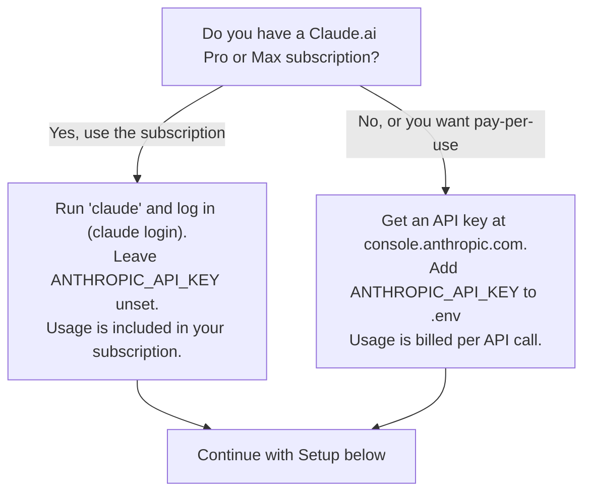

# Anthropic Provider -- Setup Guide

## Prerequisites

- Claude Code installed: `npm install -g @anthropic-ai/claude-code`
- Either a Claude.ai subscription (Pro/Max) **or** an Anthropic API key from
  [console.anthropic.com](https://console.anthropic.com)

## Choose how you authenticate

This choice changes how you are **billed** -- read it before running `claude`.



**Important:** Claude Code automatically reads a `.env` file in the project
folder. If `ANTHROPIC_API_KEY` is set there (or in your shell environment),
Claude Code will use **pay-per-use API billing**, even if you are logged in
with a subscription. If you have a subscription and want to use it, do not
set `ANTHROPIC_API_KEY` -- just run `claude` and follow the login prompt.

## Setup

```bash
cp providers/anthropic/CLAUDE.md.template CLAUDE.md
# Fill in CLAUDE.md: level, domain, competencies

# Only if you are using API-key billing (see above):
#   cp .env.example .env
#   nano .env   # add ANTHROPIC_API_KEY

claude     # launch Claude Code
```

## Recommended model

`claude-sonnet-4-6` -- best cost/performance for teaching workflows.
Use `claude-opus-4-6` for complex multi-agent assessment tasks.

## How routing works

Claude Code reads `SKILL.md` at session start. The router table maps
trigger keywords to agent files in `src/agents/`. No manual setup needed.

## Data note

Text is processed by Anthropic (US-based). Not recommended for institutions
with strict EU data residency requirements. See `providers/mistral/` for a
more EU-aligned alternative.
