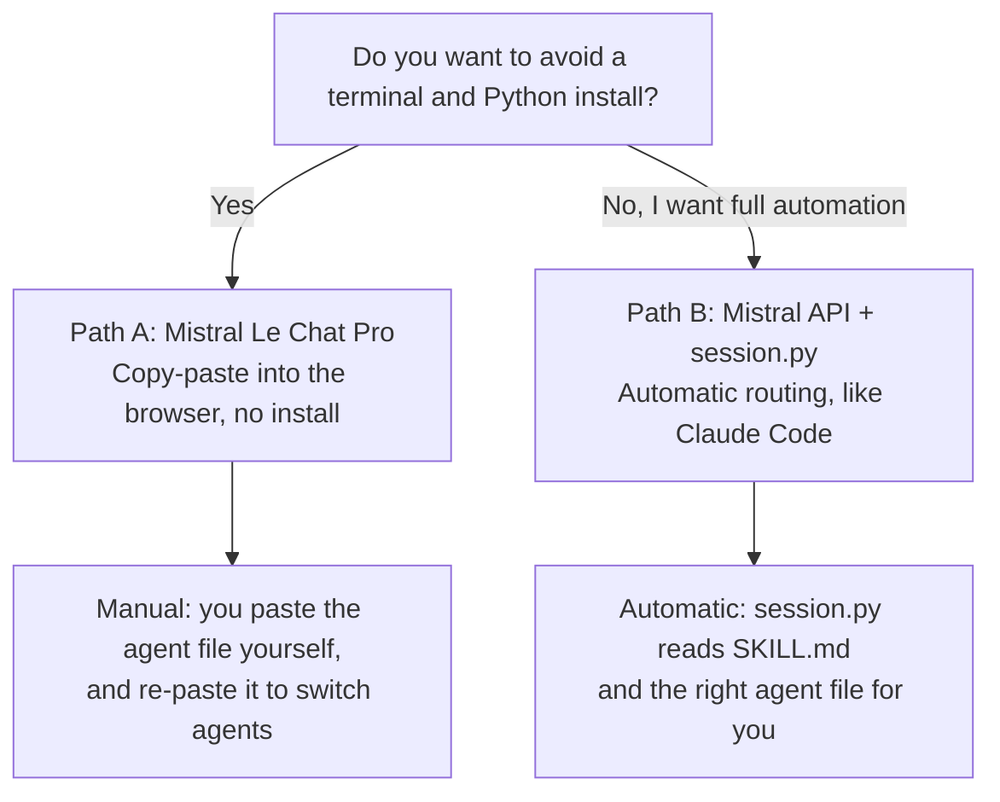
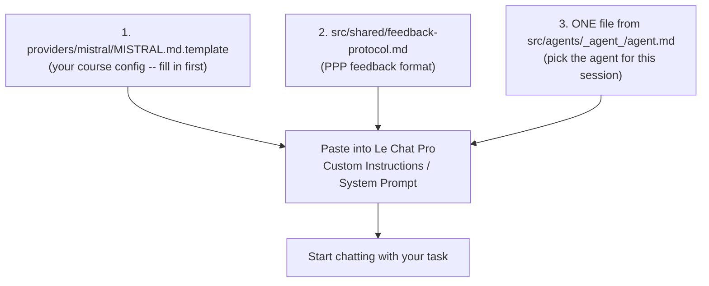

# Mistral Provider -- Setup Guide

## Why Mistral?

- **EU-hosted:** French company, data processed in the EU -- this
  facilitates RGPD compliance, but does not by itself make your usage
  compliant. Your institution still needs its own data processing
  agreement (DPA) with Mistral AI; this skill does not provide one.
- **ESR license:** Available via AMUE 2026 agreement for French universities
- **Cost:** Mistral API is generally cheaper than Anthropic at comparable quality
- **Privacy:** Preferred for institutions with strict data residency requirements

Recommended model: `mistral-large-latest`

---

## Which path should I use?



---

## Prerequisites

- A Mistral AI API key: [console.mistral.ai](https://console.mistral.ai)
- OR an ESR institutional license via AMUE
- Mistral has no agentic CLI equivalent to Claude Code -- pick Path A or B below

---

## Path A -- Mistral Le Chat Pro (no-code, recommended for teachers)

Le Chat does not read files from this repository automatically. Everything
the AI needs for a session must be pasted into the conversation, in this
order:



1. Go to [chat.mistral.ai](https://chat.mistral.ai) with a Pro account and start a new conversation.
2. Open `providers/mistral/MISTRAL.md.template`, fill in your course details (level, domain, competencies, rubric), and paste the result as the system prompt (Custom Instructions).
3. Also paste the contents of `src/shared/feedback-protocol.md` (defines the PPP feedback format every agent uses).
4. Pick the agent you need for this session and paste its file too, e.g. `src/agents/writing-coach/agent.md` for abstract/IMRAD feedback, or `src/agents/critical-reviewer/agent.md` for a peer-review simulation.
5. Start chatting with your actual task, e.g. "Review this abstract: ...".

**Switching agents:** Le Chat does not re-route automatically. To move from
Writing Coach to, say, Critical Reviewer, paste the new agent file into the
same conversation (or start a new one with steps 2-4 repeated for the new
agent).

---

## Path B -- Mistral API + session.py (developers, full automation)

```bash
pip install "mistralai<2" python-dotenv
# Note: mistralai 2.x removed the top-level "Mistral" class that
# session.py imports (from mistralai import Mistral). Stay on the 1.x
# line, or session.py will exit with an import error.

# Set your key
export MISTRAL_API_KEY=your_key_here
# Or add to .env: MISTRAL_API_KEY=...

# Run the provided session script
python providers/mistral/session.py
```

`session.py` reads `SKILL.md`'s router table and the matching
`src/agents/<agent>/agent.md` automatically -- no manual pasting needed.

---

## .env Configuration (Path B)

```bash
# In your .env file:
PROVIDER=mistral
MISTRAL_API_KEY=your_mistral_api_key
MISTRAL_MODEL=mistral-large-latest
# Options: mistral-large-latest | mistral-small-latest | open-mixtral-8x22b
```

---

## Limitations vs Claude Code

| Feature | Claude Code (Anthropic) | Mistral Le Chat Pro (Path A) | Mistral API + session.py (Path B) |
|---------|------------------------|-------------------------------|-------------------------------------|
| Agentic routing | Automatic via SKILL.md | Manual -- paste agent file | Automatic via SKILL.md |
| Memory block update | Semi-automatic | Manual copy-paste | Semi-automatic |
| File system access | Yes | No | Yes |
| Cost | API pay-per-use or subscription | Le Chat Pro subscription | API pay-per-use |
| Data hosting | US (Anthropic) | EU (Mistral) | EU (Mistral) |

For full agentic behaviour with Mistral, Path B is required; Path A trades
automation for a zero-install, browser-only workflow.

---

## ESR License Notes (French Universities)

If your institution has an AMUE Mistral ESR license:
- Verify which models are covered (typically mistral-large)
- Check if the license covers API access or Le Chat Pro only
- Data processed under ESR agreements may have additional RGPD guarantees --
  confirm the exact scope with your institution's DPO
- Contact your DSI or referent numerique for institutional endpoint details
